# Deep Dive: CUDA — Euclidean Norm - C vs Assembly vs SIMD vs CUDA

## Group Members, Specification and AI Usage

**Group 3:** Matthew Fabregas, Kane Ibanez, Bowen Li, John Teoxon

**Google Colab notebook:** https://colab.research.google.com/drive/1aB99_AnJZpkkZSQYR4ayNUfPiIx2kcsR?usp=sharing

### Project specification (from our SIMD project)

Compute the Euclidean norm of a double-precision vector `A` of length `n`:

$$Z = \sqrt{\sum_{i=0}^{n-1} A_i^2}$$

| Item | Value |
|---|---|
| Data type | `double` (8 bytes) |
| Main vector size | n = 2²⁴ = 16,777,216 elements (128 MiB) |
| Extra sizes | 2²⁰ (8 MiB) and 2²⁶ (512 MiB), the same sizes as our SIMD project |
| Initialization | `A[i] = sin(i * 0.001)` (same as our SIMD project) |
| Expected answer (2²⁴) | Z = 2896.2749920235 |
| Runs per kernel | 30 (avg, min and max reported; run 1 also reported separately) |
| CUDA block sizes | 256, 512, 1024 |
| CUDA grid size (main runs) | number of SMs × resident blocks per SM = 160 / 80 / 40 blocks on a T4 |
| CUDA grid size (comparison) | `(n + blockSize - 1) / blockSize` = maximum blocks, one element per thread |
| Correctness tolerance | relative difference ≤ 1e-9 against the C answer key |

### Versions

| # | Version | Platform |
|---|---|---|
| 1 | C program (baseline and answer key) | Colab CPU (`gcc -O2`) |
| 2 | CUDA grid-stride loop, Unified Memory, no prefetch, no page creation, no mem advise | Colab Tesla T4 |
| 3 | CUDA grid-stride loop + prefetch (no page creation, no mem advise) | Colab Tesla T4 |
| 4 | CUDA grid-stride loop + prefetch + page creation (no mem advise) | Colab Tesla T4 |
| 5 | CUDA grid-stride loop + prefetch + page creation + mem advise | Colab Tesla T4 |
| — | C, x86-64, SIMD XMM, SIMD YMM (from our SIMD project) | Laptop CPU, Visual Studio, x64 Release |

### AI usage declaration

We used Claude to assist us in our project. We noticed in some parts of the code that there are some values that don't seem to make sense, such as the grid-stride, which should vary but wasn't being implemented well. We were also confused on how page creation would be implemented and how to use NCU, so we did research via Google Search and asked Claude for help with syntax. Additionally, we asked it for assistance on what to expect and to theorize what the results would be, which is why we had to do multiple iterations to get a decent comparison of the different versions. All our results were run using a T4 GPU in Google Colab.

---

## How the CUDA programs work

All four CUDA versions run the **same kernel**. The only difference between them is how the Unified Memory is managed, so any time difference comes from memory handling.

```cuda
__global__ void norm_kernel(const double* A, long long n, double* sum) {
    extern __shared__ double s[];                    // blockSize doubles, size given at launch
    long long index  = (long long)blockIdx.x * blockDim.x + threadIdx.x;
    long long stride = (long long)blockDim.x * gridDim.x;

    double local = 0.0;
    for (long long i = index; i < n; i += stride)   // grid-stride loop
        local += A[i] * A[i];

    s[threadIdx.x] = local;                          // shared-memory block reduction
    __syncthreads();
    for (int k = blockDim.x / 2; k > 0; k >>= 1) {
        if (threadIdx.x < k)
            s[threadIdx.x] += s[threadIdx.x + k];
        __syncthreads();
    }
    if (threadIdx.x == 0)
        atomicAdd(sum, s[0]);                        // one atomic per block
}
```

The Euclidean norm is a **reduction**: every element adds into one sum. If every thread did `*sum += A[i] * A[i]`, threads would overwrite each other's updates (a race condition). So each thread first adds its own elements in a register, each block adds its threads' values in shared memory, and only thread 0 of each block does one `atomicAdd` into the global `sum`. The host then computes `sqrt(sum)`.

### Grid size: making the grid-stride loop actually loop

| Launch | Number of blocks | Elements per thread | Used for |
|---|---|---|---|
| **Blocks that fit on the GPU** (`gridMode 1`) | SMs × resident blocks per SM (from `cudaOccupancyMaxActiveBlocksPerMultiprocessor`): **160 / 80 / 40** for block size 256 / 512 / 1024 | about 410 | All main runs |
| **Maximum blocks** (`gridMode 0`) | `(n + blockSize - 1) / blockSize`: **65,536 / 32,768 / 16,384** | 1 | Comparison for guide question (a) |

With maximum blocks there is one thread per element, so `stride ≥ n` and the grid-stride loop body runs only once. With blocks that fit on the GPU, each thread walks through about 410 elements, which is the point of a grid-stride loop.

### Memory handling per version

| Version | What happens to `A` before the kernel |
|---|---|
| 2 Unified | `cudaMallocManaged`, filled on the **CPU**. The kernel page-faults and the pages migrate to the GPU on demand. |
| 3 Prefetch | Filled on the CPU, then `cudaMemPrefetchAsync(A, bytes, device)` moves it to the GPU before the kernel. |
| 4 Prefetch + page creation | The empty buffer is prefetched to the GPU, then filled by a GPU kernel (`init_kernel`, also a grid-stride loop), so its pages are **created directly in GPU memory** and nothing is copied from the CPU. |
| 5 Prefetch + page creation + mem advise | Same as 4, plus `cudaMemAdviseSetPreferredLocation` = GPU (before the prefetch) and `cudaMemAdviseSetReadMostly` (after `A` is filled, since the kernel only reads it). |

**Our definition of page creation:** `cudaMallocManaged` only reserves addresses; physical pages are created when memory is first touched. In Versions 4 and 5 we make the first touch happen on the GPU.

**Timing:** each of the 30 runs resets `sum` with `cudaMemset` (not timed), then only the kernel is timed with CUDA events. Run 1 is also reported separately because it includes any page migration, and so is the average of runs 2–30.

**Correctness:** each CUDA result is compared to the C answer key. Because the GPU adds the numbers in a different order, the last digits can differ, so a result is `CORRECT` if the relative difference is at most 1e-9 (the same tolerance as our SIMD project). A boundary test (n = 1, 3, 1000, 1001, 1002, 1003, the same sizes as our SIMD project) checks that sizes that do not divide evenly are handled.

---

## i. Program Output (correctness check and execution time)

### C program (Version 1)

<!-- SCREENSHOT: output of the Version 1 cell (!./euclid_c 24) -->
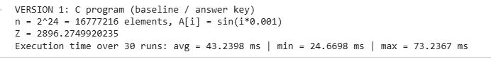

### CUDA Unified (Version 2)

<!-- SCREENSHOT: output of the Version 2 run cell (all 3 block sizes) -->
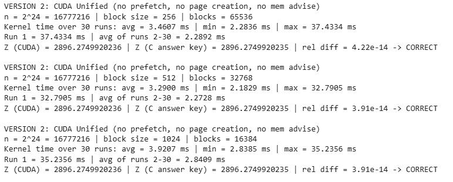

### CUDA Prefetch (Version 3)

<!-- SCREENSHOT: output of the Version 3 run cell -->
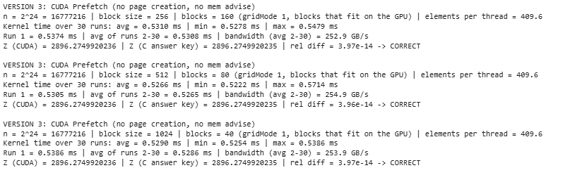

### CUDA Prefetch + page creation (Version 4)

<!-- SCREENSHOT: output of the Version 4 run cell -->
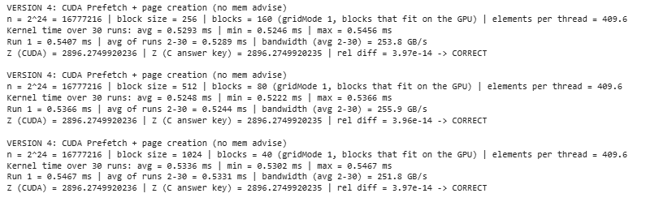

### CUDA Prefetch + page creation + mem advise (Version 5)

<!-- SCREENSHOT: output of the Version 5 run cell -->
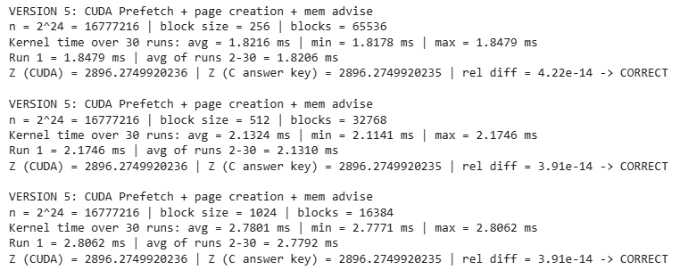

### Maximum blocks (one element per thread), all versions

<!-- SCREENSHOT(S): output of the "Block size and number of blocks" cell -->
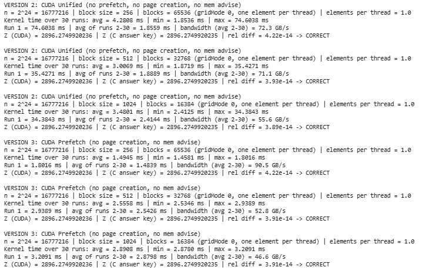
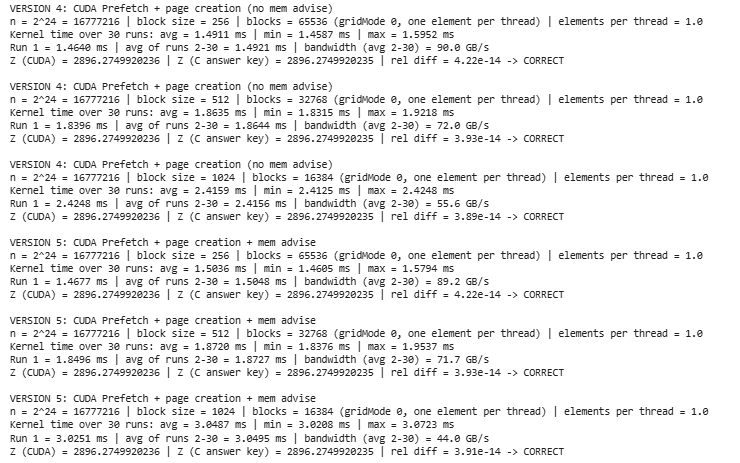

### Boundary test

<!-- SCREENSHOT: output of the boundary test cell -->
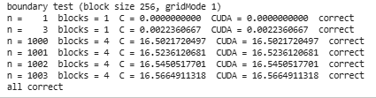

### Results summary (Colab)

<!-- SCREENSHOT: first two tables of the "Results summary" cell (main runs + gridMode 0 vs 1) -->
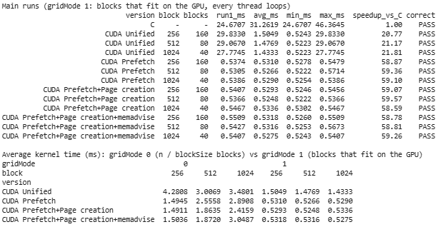

<!-- SCREENSHOT: the "All sizes" tables at the end of the "Results summary" cell -->
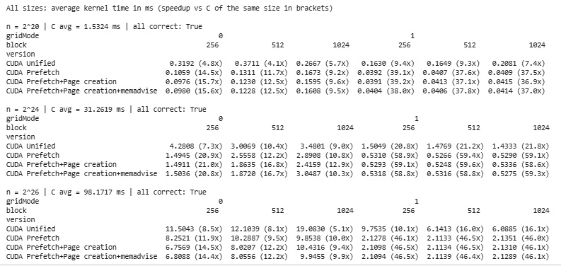

### C, x86-64, XMM and YMM (SIMD project, Visual Studio x64 Release)

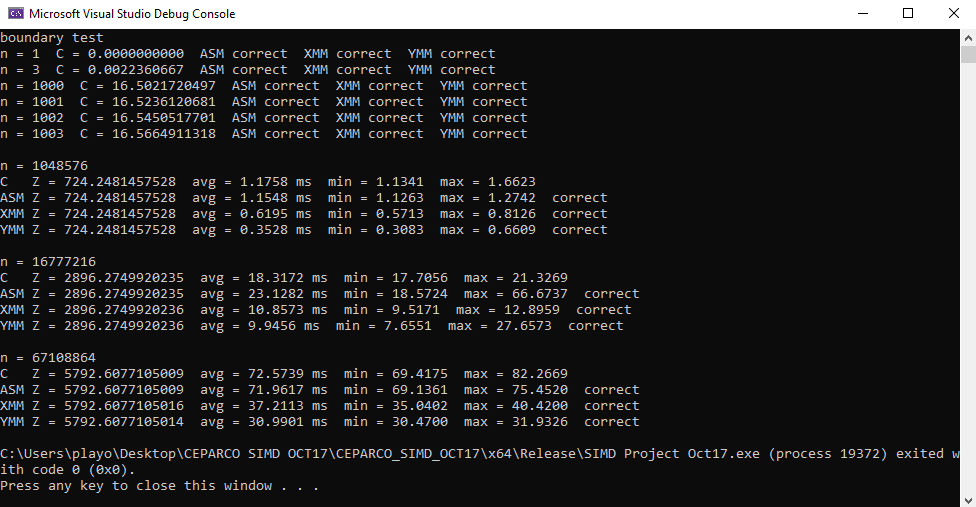

Every version printed `correct` / `CORRECT` at every size, block size and launch. All CUDA versions gave Z = 2896.2749920236 at 2²⁴ against the C answer key 2896.2749920235, a relative difference of about 4e-14. The boundary test matched C for all six sizes.

---

## ii. Nsight Systems (nsys) — all CUDA versions (2²⁴, block size 256, blocks that fit on the GPU)

For each version, the screenshot shows the kernel summary (`cuda_gpu_kern_sum`) and the memory transfer summaries (`cuda_gpu_mem_time_sum` / `cuda_gpu_mem_size_sum`). Version 2 also shows the Unified Memory totals (`um_total_sum`).

### Version 2 — CUDA Unified

<!-- SCREENSHOT: nsys for cuda_unified: cuda_gpu_kern_sum, cuda_gpu_mem_time_sum, cuda_gpu_mem_size_sum, um_total_sum -->
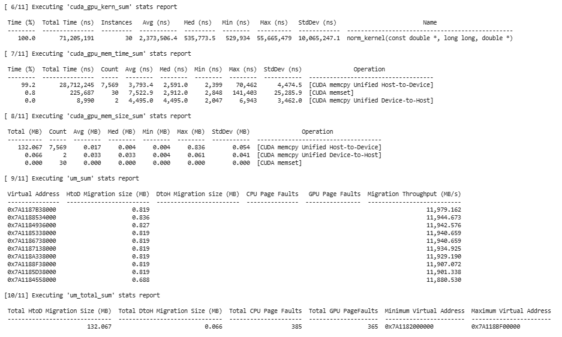

### Version 3 — CUDA Prefetch

<!-- SCREENSHOT: nsys for cuda_prefetch: cuda_gpu_kern_sum, cuda_gpu_mem_time_sum, cuda_gpu_mem_size_sum -->
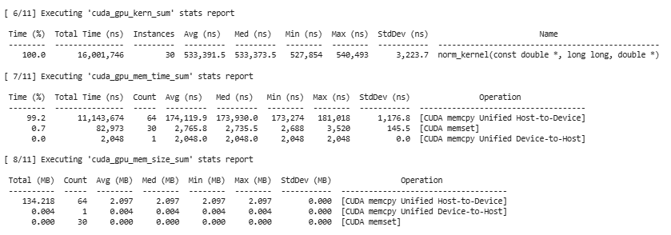

### Version 4 — CUDA Prefetch + page creation

<!-- SCREENSHOT: nsys for cuda_pages: cuda_gpu_kern_sum (shows init_kernel), cuda_gpu_mem_time_sum, cuda_gpu_mem_size_sum -->
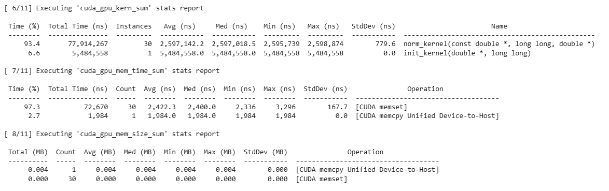

### Version 5 — CUDA Prefetch + page creation + mem advise

<!-- SCREENSHOT: nsys for cuda_advise: cuda_gpu_kern_sum, cuda_gpu_mem_time_sum, cuda_gpu_mem_size_sum -->
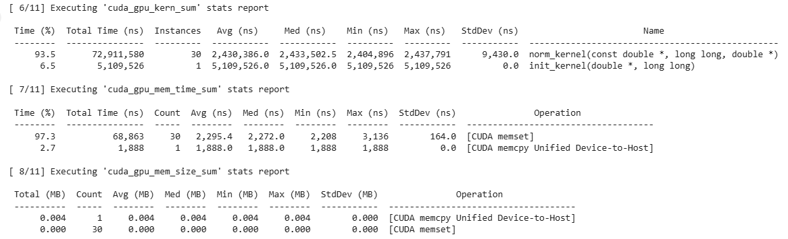

### What nsys shows

| | Unified | Prefetch | Prefetch + page creation | + mem advise |
|---|---|---|---|---|
| Host-to-Device transfers | 7,569 | 64 | 0 | 0 |
| Data moved Host-to-Device | 132.1 MB | 134.2 MB | 0 MB | 0 MB |
| Transfer size | 4 KB – 0.84 MB (avg 0.017 MB) | 2.097 MB each | — | — |
| Total transfer time | 28.71 ms | 11.14 ms | — | — |
| Transfer speed | 4.6 GB/s | 12.0 GB/s | — | — |
| GPU page faults | 365 | 0 | 0 | 0 |
| CPU page faults | 385 | 385 | 1 | 1 |
| `init_kernel` on GPU | — | — | 6.11 ms (once) | 5.89 ms (once) |
| `norm_kernel` median (30 runs) | 0.536 ms | 0.533 ms | 0.528 ms | 0.528 ms |

(nsys reports "SKIPPED … does not contain GPU page faults data" for Versions 3–5 because there were no GPU page faults to record.)

### Nsight Compute (ncu)

<!-- SCREENSHOT: ncu for cuda_unified: "GPU Speed Of Light Throughput" and "Occupancy" sections -->
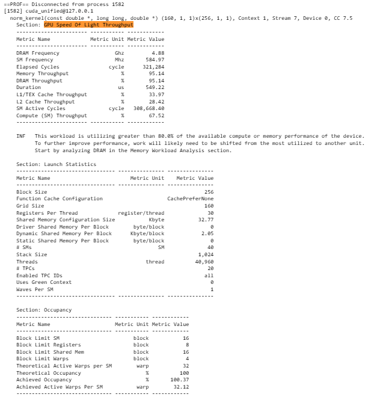

ncu profiled one `norm_kernel` launch (2²⁴, block size 256, 160 blocks) for each version. All four looked the same:

| Metric | Value (all four versions) |
|---|---|
| Duration | 0.544 – 0.553 ms |
| DRAM throughput | **93.2 – 95.2 %** |
| Compute (SM) throughput | 67.5 – 67.9 % |
| Achieved occupancy | about 100 % (theoretical 100 %) |

The kernel keeps the GPU memory almost fully busy, so it is **memory-bound**: it runs about as fast as the T4 can read 128 MB. (ncu fixes the SM clock at 585 MHz, so its durations are a little longer than our benchmark times.)

---

## iii. Comparative Table of Execution Time (2²⁴ elements)

Times are in milliseconds over 30 runs. The CUDA times are **kernel only**.

### Main table

| 2²⁴ elements | Block size | Time avg \| min \| max (ms) | Speedup vs C (same machine) |
|---|---|---|---|
| C (Colab CPU, `gcc -O2`) | — | 31.2619 \| 24.6707 \| 46.3645 | 1.00x |
| C (laptop, VS Release) | — | 18.3172 \| 17.7056 \| 21.3269 | 1.00x |
| x86-64 (laptop) | — | 23.1282 \| 18.5724 \| 66.6737 | 0.79x |
| x86-64 SIMD XMM (laptop) | — | 10.8573 \| 9.5171 \| 12.8959 | 1.69x |
| x86-64 SIMD YMM (laptop) | — | 9.9456 \| 7.6551 \| 27.6573 | 1.84x |
| CUDA Unified | 256 | 1.5049 \| 0.5243 \| 29.8330 | 20.77x |
| | 512 | 1.4769 \| 0.5223 \| 29.0670 | 21.17x |
| | 1024 | 1.4333 \| 0.5223 \| 27.7745 | 21.81x |
| CUDA Prefetch | 256 | 0.5310 \| 0.5278 \| 0.5479 | 58.87x |
| | 512 | 0.5266 \| 0.5222 \| 0.5714 | 59.36x |
| | 1024 | 0.5290 \| 0.5254 \| 0.5386 | 59.10x |
| CUDA Prefetch + page creation | 256 | 0.5293 \| 0.5246 \| 0.5456 | 59.07x |
| | 512 | **0.5248 \| 0.5222 \| 0.5366** | **59.57x** |
| | 1024 | 0.5336 \| 0.5302 \| 0.5467 | 58.59x |
| CUDA Prefetch + page creation + mem advise | 256 | 0.5318 \| 0.5260 \| 0.5509 | 58.78x |
| | 512 | 0.5316 \| 0.5253 \| 0.5673 | 58.81x |
| | 1024 | 0.5275 \| 0.5243 \| 0.5407 | 59.26x |

CUDA rows use the main launch (blocks that fit on the GPU: 160 / 80 / 40 blocks).

**Which C is the baseline?** The CUDA speedups are against the C program on the **same Colab machine** (31.26 ms). The x86-64, XMM and YMM speedups are against the C program on the **same laptop** (18.32 ms). Comparing each version with C on its own machine keeps the CPU hardware out of the comparison. A cross-platform comparison is further below.

### Run 1 vs the other 29 runs (block size 256)

| Version | Run 1 (ms) | Avg of runs 2–30 (ms) |
|---|---|---|
| CUDA Unified | 29.8330 | 0.5281 |
| CUDA Prefetch | 0.5374 | 0.5308 |
| CUDA Prefetch + page creation | 0.5407 | 0.5289 |
| CUDA Prefetch + page creation + mem advise | 0.5509 | 0.5312 |

### Blocks that fit on the GPU vs maximum blocks (2²⁴, average kernel time in ms)

| Version | Max blocks 256 | Max blocks 512 | Max blocks 1024 | Fit 256 | Fit 512 | Fit 1024 |
|---|---|---|---|---|---|---|
| Blocks launched | 65,536 | 32,768 | 16,384 | 160 | 80 | 40 |
| CUDA Unified | 4.2808 | 3.0069 | 3.4801 | 1.5049 | 1.4769 | 1.4333 |
| CUDA Prefetch | 1.4945 | 2.5558 | 2.8908 | 0.5310 | 0.5266 | 0.5290 |
| CUDA Prefetch + page creation | 1.4911 | 1.8635 | 2.4159 | 0.5293 | 0.5248 | 0.5336 |
| CUDA Prefetch + page creation + mem advise | 1.5036 | 1.8720 | 3.0487 | 0.5318 | 0.5316 | 0.5275 |
| Bandwidth (page creation, runs 2–30) | 90 GB/s | 72 GB/s | 56 GB/s | 254 GB/s | 256 GB/s | 252 GB/s |

### Other sizes: 2²⁰ and 2²⁶ (average kernel time in ms; speedup vs Colab C of the same size)

| Version | 2²⁰ max blocks (256 / 512 / 1024) | 2²⁰ fit (256 / 512 / 1024) | 2²⁶ max blocks (256 / 512 / 1024) | 2²⁶ fit (256 / 512 / 1024) |
|---|---|---|---|---|
| C (Colab) | 1.5324 | | 98.1717 | |
| CUDA Unified | 0.3192 / 0.3711 / 0.2667 | 0.1630 / 0.1649 / 0.2081 | 11.5043 / 12.1039 / 19.0830 | 9.7535 / 6.1413 / 6.0885 |
| CUDA Prefetch | 0.1059 / 0.1311 / 0.1673 | 0.0392 / 0.0407 / 0.0409 | 8.2521 / 10.2887 / 9.8538 | 2.1278 / 2.1133 / 2.1351 |
| CUDA Prefetch + page creation | 0.0976 / 0.1230 / 0.1595 | **0.0391** / 0.0413 / 0.0415 | 6.7569 / 8.0207 / 10.4316 | 2.1098 / 2.1134 / 2.1310 |
| CUDA Prefetch + page creation + mem advise | 0.0980 / 0.1228 / 0.1608 | 0.0404 / 0.0406 / 0.0414 | 6.8088 / 8.0556 / 9.9455 | **2.1094** / 2.1139 / 2.1289 |
| Best speedup vs Colab C | 15.7x | **39.2x** | 14.5x | **46.5x** |

### Cross-platform comparison (everything against the laptop C)

| 2²⁴, best block size | Avg time (ms) | Speedup vs laptop C (18.32 ms) | Effective bandwidth |
|---|---|---|---|
| C (laptop) | 18.3172 | 1.00x | 7.3 GB/s |
| x86-64 SIMD YMM (laptop) | 9.9456 | 1.84x | 13.5 GB/s |
| CUDA Unified (1024) | 1.4333 | 12.8x | — |
| CUDA Prefetch (512) | 0.5266 | 34.8x | 255 GB/s |
| CUDA Prefetch + page creation (512) | 0.5248 | **34.9x** | **256 GB/s** |
| CUDA Prefetch + page creation + mem advise (1024) | 0.5275 | 34.7x | 254 GB/s |
| **CUDA Unified, run 1 only (256)** | **29.8330** | **0.61x** | — |

| Other sizes | Laptop C | Laptop YMM | Best CUDA | CUDA vs YMM |
|---|---|---|---|---|
| 2²⁰ | 1.1758 ms | 0.3528 ms | 0.0391 ms | 9.0x faster |
| 2²⁶ | 72.5739 ms | 30.9901 ms | 2.1094 ms | 14.7x faster |

Effective bandwidth = bytes read / time = (n × 8 bytes) / time, using the formula from the lecture. The T4's theoretical memory bandwidth is 320 GB/s (lecture 2).

---

## iv. Analysis of Results

### Kernel execution time

**1. The first run of the Unified version is more than 50x slower than the rest.** Run 1 of CUDA Unified took 27.8–29.8 ms, but runs 2–30 took only about 0.53 ms. In the Unified version `A` is filled on the CPU, so its pages live in CPU memory. When the kernel touches a page that is not on the GPU, the GPU stalls, the page migrates, and then the threads continue. nsys shows this clearly: 365 GPU page faults and 7,569 small Host-to-Device transfers moving 132 MB, all inside the first kernel. After run 1 the data stays on the GPU, so runs 2–30 have no faults. This is why the **max** column for CUDA Unified is more than 50x the minimum, and why its 30-run average (1.43–1.50 ms) is almost 3x the other versions.

**2. Prefetching removes the slow first run.** In CUDA Prefetch, run 1 (0.537 ms) is almost the same as the other runs (0.531 ms). The 128 MB are moved before the kernel starts. nsys shows the prefetch moved 134.2 MB in only **64 transfers of 2 MB**, at 12.0 GB/s, compared with 4.6 GB/s for the on-demand migration in Version 2. Large transfers use the PCIe bus much better than thousands of small faults.

**3. Page creation removes the transfer completely.** In Versions 4 and 5, `A` is created and filled on the GPU, so nsys shows **0 bytes** copied from host to device (only the 4 KB `sum` result is copied back), and the CPU page faults drop from 385 to 1. Filling the vector on the GPU took about 6 ms (`init_kernel`), which is not part of the kernel time. Versions 2 and 3 fill it on the CPU instead, computing 16.7 million `sin` values on one CPU core.

**4. Once the data is on the GPU, Versions 3, 4 and 5 run the kernel at the same speed.** Their averages are 0.525–0.534 ms at every block size, and their ranges overlap. nsys (medians 0.528–0.533 ms) and ncu (0.544–0.553 ms at a fixed clock) agree. The kernel does the same work on the same data in GPU memory, so prefetch, page creation and mem advise only change **how and when the data gets to the GPU**, not how fast the kernel reads it afterwards. Mem advise gave no measurable gain here: our data is read once per run by the GPU and is never shared with the CPU, so there is nothing for the hints to improve.

**5. The kernel is memory-bound and close to the hardware limit.** The best runs reached about **256 GB/s**, 80% of the T4's theoretical 320 GB/s, and ncu shows DRAM throughput at **93–95%** while the SMs are only about 68% busy. Each element needs 8 bytes from memory but only one multiply-add, so the GPU spends its time waiting for data, not computing. Our results show that the GPU is already using most of its memory bandwidth. Because of this, adding more threads may not improve the performance much. Other optimizations might help, but we did not test them in this project.
**6. Run-to-run variation.** Times can shift between program runs because the Colab GPU's clock speed changes with temperature and load (it boosts when busy and slows down when hot or idle). For example, CUDA Prefetch at block size 512 with maximum blocks took 2.56 ms, while Versions 4 and 5 took 1.86–1.87 ms in the same configuration, even though the kernel is identical. Within one run the min and avg are very close, so this is a clock effect, not a code difference. We noticed that the execution time was not always the same. This might be caused by changes in GPU clock speed or other activities in Google Colab. Because of this, we compared the average, minimum, and maximum times instead of only looking at one run.

### a) How does block size affect execution time (various sizes, maximum blocks)? Which block size do we recommend?

**It depends on how many blocks are launched.**

**With maximum blocks (one element per thread), block size matters a lot, and 256 is best.** At 2²⁴, Versions 3–5 took about 1.49 ms at 256, 1.86–2.56 ms at 512 and 2.42–3.05 ms at 1024. The same pattern appears at 2²⁰ (0.098 → 0.123 → 0.160 ms) and 2²⁶ (6.76 → 8.02 → 10.43 ms for Version 4). Why:
- Each thread does only **one** multiply-add, then takes part in the shared-memory reduction (8 steps at 256, 10 steps at 1024), each with a `__syncthreads()`, then one thread per block does an `atomicAdd`. This per-block overhead is most of the work.
- The T4 allows at most 1,024 threads per SM (lecture 3). With 256 threads per block, 4 blocks share an SM, so while one block waits at a barrier the others keep loading data. With 1024 threads per block only 1 block fits, so the whole SM waits at every barrier.
- In our first version of the notebook, ncu showed this launch at only 14% DRAM throughput but 83% SM throughput: the GPU was busy with overhead, not with reading data.

**With blocks that fit on the GPU, block size barely matters.** At 2²⁴ all three block sizes took 0.525–0.534 ms (under 2% apart, inside the noise), and the same holds at 2²⁰ (0.039–0.042 ms) and 2²⁶ (2.11–2.14 ms). Each thread now adds about 410 elements in the grid-stride loop before the reduction, so the reduction and atomic overhead is paid once per thread instead of once per element, and the kernel becomes limited only by memory speed. The launch made a much bigger difference than block size: **2.8x to 4.5x faster** than maximum blocks at 2²⁴, and 3.2x to 4.9x at 2²⁶.

**The vector size matters too.** The bandwidth with blocks that fit was 215 GB/s at 2²⁰, but about 255 GB/s at 2²⁴ and 2²⁶. At 2²⁰ the whole kernel takes only 39 µs, so the fixed cost of launching the kernel and doing the final reduction is a bigger share of the time.

**Recommendation:** launch **blocks that fit on the GPU** (SMs × resident blocks per SM) with a **block size of 256**. With that launch 256, 512 and 1024 are equally fast, and 256 is clearly the best if a program does end up launching one thread per element. It also gives the scheduler 4 blocks per SM to switch between.

### b) Is prefetching always recommended, or should CUDA manage memory?

For our use case, **prefetching (or creating the data on the GPU) is clearly better.** We read the whole vector in order, and we know in advance that the GPU needs all of it. Prefetching moved the data in 64 chunks of 2 MB at 12.0 GB/s, instead of 7,569 small on-demand transfers at 4.6 GB/s, and removed the 28–30 ms first-run penalty.

Prefetching is **not always** the best choice. Letting CUDA manage memory on demand can be better when:

- **The GPU only touches a small or unpredictable part of a large array** (for example a sparse lookup, a graph traversal, or a search that stops early). Prefetching everything would move data that is never used, while on-demand faults move only the pages that are actually touched.
- **The data is bigger than GPU memory.** Unified Memory can oversubscribe GPU memory and page in what is needed; prefetching all of it is not possible.
- **The CPU and GPU take turns working on the same data in small pieces.** Prefetching back and forth every time can cost more than letting only the touched pages move.
- **Simplicity matters more than speed,** such as in a prototype or a program that runs once on a small array.

Prefetching is better when the kernel reads (almost) all of the data, the access pattern is known in advance, and the data fits in GPU memory, which is exactly the case for vector operations like ours. Based on our results, Versions 4 and 5 avoided transferring the vector from the CPU to the GPU because the data was created directly on the GPU. This reduced the data transfer overhead. However, generating the vector on the GPU still took around 6 ms.

Note: lecture 2 mentions that Windows does not support on-demand page migration (data is automatically prefetched). Colab runs Linux, so our Version 2 really shows the cost of on-demand page faults.

### c) Between SIMD and SIMT, which one is faster?

**For the kernel alone, SIMT on the GPU is much faster.** At 2²⁴ the best CUDA version (0.525 ms) was **19x faster than YMM** (9.95 ms) and **35x faster than C** (18.32 ms) on our laptop. At 2²⁰ CUDA was 9x faster than YMM, and at 2²⁶ 14.7x faster. The GPU reads memory at about 255 GB/s; the laptop CPU running YMM reached only 13.5 GB/s.

**But it depends on where the data starts.** If the data is created on the CPU and used only once, the GPU must first receive 128 MB over PCIe. In our Unified version, the first run (with the migration) took 29.8 ms, which is **slower than plain C on the laptop (18.32 ms)** and 3x slower than YMM. Even with prefetch, moving the data took 11.1 ms, which is longer than YMM needed to compute the whole answer (9.95 ms).In our Euclidean norm project, each element only needs to be squared and added to the sum. We found that transferring a large vector to the GPU can take more time than computing the result using CPU SIMD. This means using CUDA is not always faster, especially when the data is only used once.
SIMD (CPU) is better when:
- the data is already in CPU memory and is used once, as in a single norm of a freshly computed vector;
- the vector is small (at 2²⁰ elements, YMM took only 0.35 ms, much less than a GPU transfer plus kernel launch);
- there is no NVIDIA GPU, or the computation is part of a mostly sequential CPU program.

SIMT (GPU) is better when:
- the data is already on the GPU or can be created there (Versions 4 and 5);
- the same data is used many times, so the transfer is paid once and spread over many kernel runs (our 30-run benchmark is an example);
- the data is large and there is a lot of independent work per element.

### Speed across all platforms

From slowest to fastest kernel time at 2²⁴: Colab C (31.3 ms) → x86-64 (23.1 ms) → laptop C (18.3 ms) → XMM (10.9 ms) → YMM (9.9 ms) → CUDA Unified (1.43–1.50 ms average, but 28–30 ms in run 1) → CUDA Prefetch / page creation / mem advise (0.525–0.534 ms).

- **C on two machines:** the same C code took 31.3 ms on Colab's CPU but 18.3 ms on our laptop, and the Colab times were noisy (24.7–46.4 ms) because the Colab CPU is shared. This is why we compare each version with C on its own machine.
- **x86-64 vs C:** in Release mode the compiler keeps `i` and `sum` in registers just like our hand-written assembly, so x86-64 and C are about tied. At 2²⁰ and 2²⁶ they were within 2%, and x86-64's best run at 2²⁴ (18.57 ms) matched C. Its 2²⁴ average (23.1 ms) was pulled up by a few runs interrupted by other programs on the laptop (max 66.7 ms).
- **XMM and YMM** were 1.69x and 1.84x faster than C, below the theoretical 2x and 4x, because the CPU kernel is limited by memory speed (YMM read at only 13.5 GB/s).
- **CUDA** was about 35x faster than laptop C for the kernel itself. Both the CPU SIMD versions and the GPU are limited by memory speed, but the T4's memory is about 19x faster than what one CPU core can read.

---

## v. Problems Encountered, Solutions and AHA Moments

- **Our first grid-stride loop never looped.** In our first version we launched `(n + blockSize - 1) / blockSize` blocks, one thread per element, so `stride = n` and every thread ran the loop body once. The code was correct but did not really use a grid-stride loop, and 65,536 blocks each did their own reduction and `atomicAdd`. A teammate caught this when reviewing the notebook. **Solution:** launch only the blocks that fit on the GPU (SMs × resident blocks per SM, from `cudaOccupancyMaxActiveBlocksPerMultiprocessor`), so each thread loops over about 410 elements. The kernel got 2.8x faster (1.49 → 0.53 ms at block size 256) and went from about 90 GB/s to 255 GB/s. We kept the old launch as a comparison for guide question (a).
- **The norm is a reduction, which is harder on a GPU.** A simple `*sum += A[i] * A[i]` in every thread is a race condition (lecture 4), and an `atomicAdd` for every element would serialize 16.7 million updates. **Solution:** each thread adds its elements in a register, each block adds its threads' values in shared memory, and only one `atomicAdd` per block goes to global memory.
- **The lecture's prefetch and mem advise calls did not compile on Colab.** Colab uses CUDA 13.0, which changed `cudaMemPrefetchAsync` and `cudaMemAdvise` to take a `cudaMemLocation` instead of a device number. **Solution:** small wrapper functions that check `CUDART_VERSION` and use the right form, so the notebook works on CUDA 12 and 13.
- **"Page creation" is not a CUDA function.** We had to decide what it means. We defined it as creating the pages directly in GPU memory by prefetching the empty buffer and then filling it with a GPU kernel. nsys confirmed it worked: 0 bytes copied from host to device.
- **The GPU result does not exactly match C.** The GPU adds in a different order, so the last digits differ (2896.2749920236 vs 2896.2749920235). **Solution:** compare with a relative tolerance of 1e-9, as in our SIMD project. The actual difference was about 4e-14.
- **Colab silently gave us a CPU-only runtime.** After uploading a new version of the notebook, "Run all" failed with `No such file or directory`. The real cause was in the first cell: `nvidia-smi` and `nvcc` were "command not found", because the uploaded notebook had started on a CPU runtime, and failing `!nvcc` lines do not stop "Run all". **Solution:** select the T4 GPU runtime before running and check the first cell's output.
- **Our SIMD program did not have 2²⁴ or min/max.** Our earlier project measured 2²⁰, 2²⁶ and 2³⁰ and only reported averages. We added 2²⁴ and min/max timing. The first re-run still showed the old sizes because Visual Studio had the old file open and saved it over our change; reloading the file fixed it.
- **The profilers change the timings.** Under ncu, run 1 took over 2 seconds because ncu replays the kernel 10 times to collect counters, and nsys also adds overhead. **Solution:** all benchmark numbers come from the normal (unprofiled) runs; the profilers are used only to explain them.
- **Colab timings vary between runs.** The GPU clock changes with temperature and load, and the Colab CPU is shared. We report avg, min and max, report run 1 separately, and only treat differences larger than the run-to-run noise as real.

**AHA moments**

- **Fewer blocks made the kernel faster.** We expected launching one thread per element (the most parallelism) to be fastest, but launching only the 160 blocks that fit on the GPU was 2.8x faster, because each thread's reduction and atomic overhead is shared over 410 elements.
- **Block size stopped mattering once the launch was right.** With maximum blocks, 1024 was up to 2x slower than 256. With blocks that fit on the GPU, 256, 512 and 1024 were within 2% of each other.
- **Faults vs prefetch is about transfer size.** Both moved about the same 132–134 MB, but on-demand faults used 7,569 small transfers at 4.6 GB/s, while prefetch used 64 transfers of 2 MB at 12.0 GB/s.
- **The fastest transfer is no transfer.** We found that creating the data directly on the GPU was useful because we did not need to transfer the vector from the CPU. The GPU took around 6 ms to initialize the data.
- **Moving the data can cost more than computing it.** The 128 MB transfer to the GPU (11–29 ms) took longer than YMM needed to compute the whole norm on the CPU (9.9 ms). The GPU only wins when the data is already there or is reused.
- **Both CPU and GPU are limited by memory, at very different speeds.** On the CPU, wider SIMD barely helped because RAM was the bottleneck (13.5 GB/s). On the GPU, ncu showed 95% DRAM use, so the kernel runs at about 255 GB/s, and adding threads cannot make it faster.

---

## vi. SIMD vs SIMT

### How each one handles parallelism in our project

**SIMD (XMM / YMM on the CPU):** one CPU thread runs one instruction stream, and each instruction works on a wider register: 2 doubles in XMM, 4 in YMM. We had to write the parallelism ourselves in assembly: load 4 doubles with `vmovupd`, square them with `vmulpd`, add them to 4 partial sums with `vaddpd`, combine the 4 lanes at the end, and handle the 1–3 leftover elements with a scalar loop. The parallelism is limited to the register width (at most 4 doubles per instruction with YMM) on one core.

**SIMT (CUDA on the GPU):** we write the code for **one thread** (add up my elements), and the GPU runs it on 40,960 threads (160 blocks × 256). Threads are grouped into warps of 32 that execute the same instruction together, which is SIMD inside the hardware, but each thread has its own index, registers and control flow. The hardware hides memory latency by switching between the many warps on each SM. Leftover elements are handled automatically by the `i < n` check in the grid-stride loop (our boundary test passed for n = 1, 3, 1000–1003), so we did not need a separate tail loop. The cost is that threads cannot simply share a sum: we needed shared memory, `__syncthreads()` and `atomicAdd`, and we had to choose the launch configuration carefully.

### Pros and cons for our use case (Euclidean norm)

| | SIMD (XMM / YMM) | SIMT (CUDA) |
|---|---|---|
| **Speed (kernel only, 2²⁴)** | YMM 9.95 ms, 1.84x faster than C | 0.525 ms, 35x faster than laptop C, 19x faster than YMM |
| **Data transfer** | None, data is already in RAM | 128 MB must reach GPU memory (11–29 ms), unless created there |
| **Reduction (the sum)** | Easy: keep 2 or 4 partial sums in one register, combine at the end | Harder: shared memory, barriers and atomics needed to avoid race conditions |
| **Leftover elements** | Need a separate scalar tail loop | Handled by the `i < n` check |
| **Tuning** | Mainly register width | Launch configuration matters a lot (up to 4.5x between our two launches) |
| **Programming effort** | Low-level assembly, register by register | High-level C++, but memory management and launch configuration must be tuned |
| **Scaling** | Limited by register width (4 doubles) and one core | Tens of thousands of threads; scales with GPU size |
| **Bottleneck in our results** | Memory bandwidth (13.5 GB/s) | Memory bandwidth (about 255 GB/s, 95% DRAM use) |
| **Hardware needed** | Any modern x86-64 CPU | An NVIDIA GPU |

**Summary:** Based on our tests, SIMD is a good choice for smaller data because it does not need to transfer data to the GPU. CUDA is faster when the data is already on the GPU, especially for larger vectors, so it is the better choice when the data is already on the GPU, can be created there, or is reused many times, so the transfer cost is paid only once.
